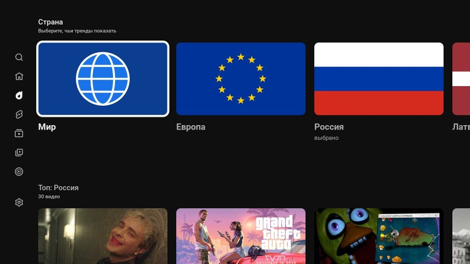
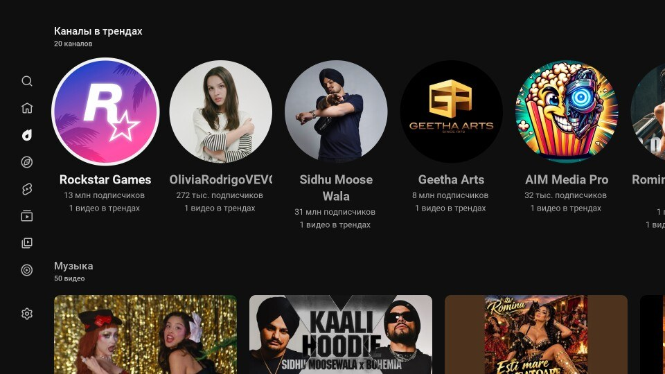
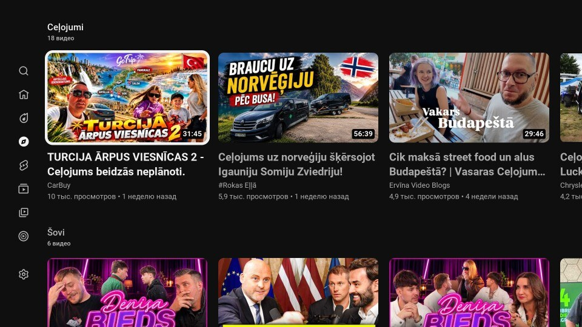
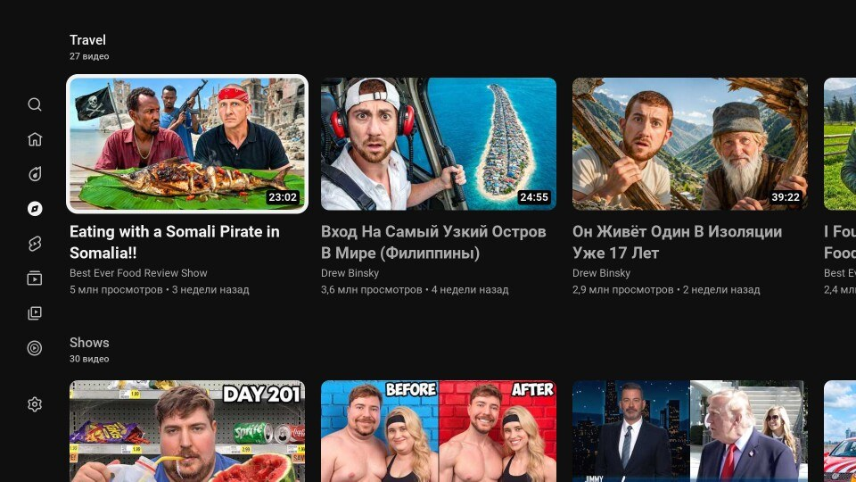
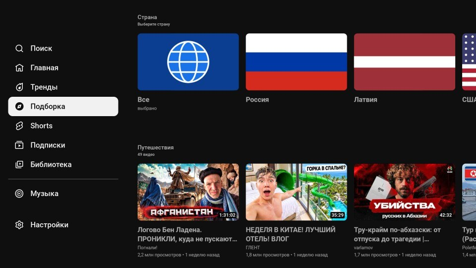

# youtube-webos-trends

YouTube AdFree for LG webOS TVs, with two extra tabs: **Trends** and **Picks**.

This is a fork of [webosbrew/youtube-webos](https://github.com/webosbrew/youtube-webos)
(v0.5.3). Everything the original app does (ad blocking, SponsorBlock, Shorts removal,
autostart, the settings screen on the green button) comes from upstream unchanged.
This fork only adds the parts listed below.

| Trends: pick a country                             | Trends: channels row                                        |
| -------------------------------------------------- | ----------------------------------------------------------- |
|    |  |
| **Picks: Latvia**                                  | **Picks: USA**                                              |
|  |                 |

## What this fork adds

### Trends tab

YouTube retired its Trending page in July 2025, on every platform. This tab rebuilds it
from the YouTube Data API `mostPopular` chart.

- A row of flags on top: **World**, **Europe**, **Russia**, **Latvia**, **USA**. World
  and Europe merge the charts of ten countries each; a video near the top in many
  countries ranks first. The last choice is remembered.
- Rows: Top, Channels in trends (round tiles that open the channel), Music, Game
  trailers, Film and entertainment, Other. Up to 50 videos per row.
- Filtered out: Roblox, Minecraft, anime, cartoons, videos made for kids, and gameplay
  footage (game trailers and announcements stay).

### Picks tab

Rows of long videos (no Shorts, nothing for kids) about travel and shows, with its own
country row: **All**, **Russia**, **Latvia**, **USA**.

- Russia: popular travel videos of the last two weeks (search), new videos from travel
  channels, shows.
- Latvia: Latvian travel vlogs and shows (search), Russian-speaking channels from Riga.
- USA: travel and show channels.

The channel lists are in [`src/trends/sources.ts`](src/trends/sources.ts); edit them to
taste.

### Menu fix

When the left menu opens, YouTube TV slides the whole 1920px page to the right without
shrinking it, so the right part leaves the screen, and the menu's background covers the
first letters of the page. This fork shrinks the page to fit beside the open menu
instead, on every page. ([`src/guide-fit/`](src/guide-fit))



### Smaller things

- Movies, Gaming and Sports are hidden from the menu.

## Building

You need your own **YouTube Data API v3 key** (free; Google Cloud Console → enable
"YouTube Data API v3" → Credentials → API key, restricted to that API). The key is
baked into the build and is never committed. Do not publish an `.ipk` built with your
key.

```sh
git clone https://github.com/Dazzyelv/youtube-webos-trends.git
cd youtube-webos-trends
pnpm install
YTAF_TRENDS_KEY=AIza... pnpm run build
pnpm run package          # youtube.leanback.v4_<version>_all.ipk
pnpm run test:trends      # the tests of this fork's code
```

Install it like the original app (the official YouTube app must be uninstalled first),
for example with the webOS CLI over Developer Mode:

```sh
pnpm exec ares-setup-device      # add the TV (Developer Mode, port 9922)
pnpm exec ares-novacom --device tv --getkey   # needs "Key Server" on in the Developer Mode app
pnpm exec ares-install -d tv youtube.leanback.v4_*_all.ipk
```

The free API quota (10,000 units a day) is plenty: the pages are cached for three
(Trends) and six (Picks) hours, and a full refresh of everything costs a few hundred
units.

## How it works

The app is YouTube's own TV web app (`youtube.com/tv`) with a user script injected by
webOS; this fork adds to that script.

- **The menu**: the guide response is patched as YouTube parses it (a `JSON.parse` hook,
  the same trick the ad blocker uses) to add Trends and Picks and drop the hidden topics.
- **The pages**: YouTube TV loads pages over `XMLHttpRequest`. When it asks for one of
  our pages, the request is sent for a real page instead and that page's `contents` are
  replaced with our rows, built from the Data API.
- **Remembered country**: YouTube TV caches a page per id, so the menu entries are
  rewritten at the moment they are chosen to the remembered country's own page.

Code: [`src/trends/`](src/trends) (`core.ts` is the pure, tested part; `index.ts` wires
it into the page; `sources.ts` lists the Picks rows), [`src/guide-fit/`](src/guide-fit),
tests in [`tests/`](tests).

## Credits and license

Based on [webosbrew/youtube-webos](https://github.com/webosbrew/youtube-webos), itself a
fork of [FriedChickenButt/youtube-webos](https://github.com/FriedChickenButt/youtube-webos).
GPL-3.0, like the original. Not affiliated with YouTube or Google.

---

# Original README (webosbrew/youtube-webos)

## Features

- Advertisements blocking
- [SponsorBlock](https://sponsor.ajay.app/) integration
- [Autostart](#autostart)

**Note:** Configuration screen can be opened by pressing 🟩 GREEN button on the remote.

## Pre-requisites

- Official YouTube app needs to be uninstalled before installation.

## Installation

- Use [webOS Homebrew Channel](https://github.com/webosbrew/webos-homebrew-channel) - app is published in official webosbrew repo
- Use [Device Manager app](https://github.com/webosbrew/dev-manager-desktop) - see [Releases](https://github.com/webosbrew/youtube-webos/releases) for a
  prebuilt `.ipk` binary file
- Use [webOS TV CLI tools](https://webostv.developer.lge.com/develop/tools/cli-installation) -
  `ares-install youtube...ipk` (For more information on configuring the webOS CLI tools, see [below](#development-tv-setup))

## Configuration

Configuration screen can be opened by pressing 🟩 GREEN button on the remote.

### Autostart

In order to autostart an application the following command needs to be executed
via SSH or Telnet:

```sh
luna-send-pub -n 1 'luna://com.webos.service.eim/addDevice' '{"appId":"youtube.leanback.v4","pigImage":"","mvpdIcon":""}'
```

This will make "YouTube AdFree" display as an eligible input application (next
to HDMI/Live TV, etc...), and, if it was the last selected input, it will be
automatically launched when turning on the TV.

This will also greatly increase startup performance, since it will be runnning
constantly in the background, at the cost of increased idle memory usage.
(so far, relatively unnoticable in normal usage)

In order to disable autostart run this:

```sh
luna-send-pub -n 1 'luna://com.webos.service.eim/deleteDevice' '{"appId":"youtube.leanback.v4"}'
```

## Building

- Clone the repository

```sh
git clone https://github.com/webosbrew/youtube-webos.git
```

- Enter the folder and build the App, this will generate a `*.ipk` file.

```sh
cd youtube-webos

# Install dependencies (need to do this only when updating local repository / package.json is changed)
npm install

npm run build && npm run package
```

## Development TV setup

These instructions use the [webOS CLI tools](https://github.com/webos-tools/cli).
See <https://webostv.developer.lge.com/develop/tools/cli-introduction> for more information.

### Configuring webOS CLI tools with Developer Mode App

This is partially based on <https://webostv.developer.lge.com/develop/getting-started/developer-mode-app>.

- Install Developer Mode app from Content Store
- Enable Developer Mode
- Enable key server and download TV's private key: `http://TV_IP:9991/webos_rsa`  
  The key must be saved under `~/.ssh` (or `%USERPROFILE%\.ssh` on Windows)
- Configure the device using `ares-setup-device` (`-a` may need to be replaced with `-m` if device named `webos` is already configured)
  - `PASSPHRASE` is the 6-character passphrase printed on screen in developer mode app
  - `privatekey` path is relative to `${HOME}/.ssh` (Windows: `%USERPROFILE%\.ssh`)

```sh
ares-setup-device -a webos -i "username=prisoner" -i "privatekey=webos_rsa" -i "passphrase=PASSPHRASE" -i "host=TV_IP" -i "port=9922"
```

### Configuring webOS CLI tools with Homebrew Channel / root

- Enable SSH in Homebrew Channel app
- Generate SSH key on developer machine (`ssh-keygen -t rsa`)
- Copy the private key (`id_rsa`) to the `~/.ssh` directory (or `%USERPROFILE%\.ssh` on Windows) on the local computer
- Append the public key (`id_rsa.pub`) to the `/home/root/.ssh/authorized_keys` file on the TV
- Configure the device using `ares-setup-device` (`-a` may need to be replaced with `-m` if device named `webos` is already configured)
  - `privatekey` path is relative to `${HOME}/.ssh` (Windows: `%USERPROFILE%\.ssh`)

```sh
ares-setup-device -a webos -i "username=root" -i "privatekey=id_rsa" -i "passphrase=SSH_KEY_PASSPHRASE" -i "host=TV_IP" -i "port=22"
```

## Installation

```sh
npm run deploy
```

## Launching

- The app will be available in the TV's app list. You can also launch it using the webOS CLI tools.

```sh
npm run launch
```

To jump immediately into some specific video use:

```sh
npm run launch -- -p '{"contentTarget":"v=F8PGWLvn1mQ"}'
```
